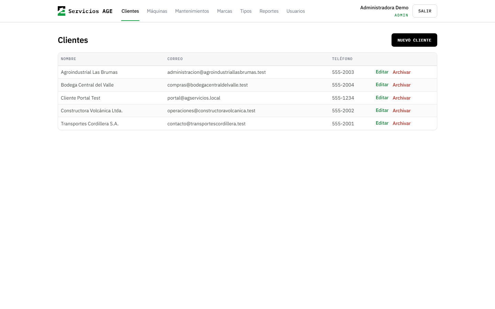
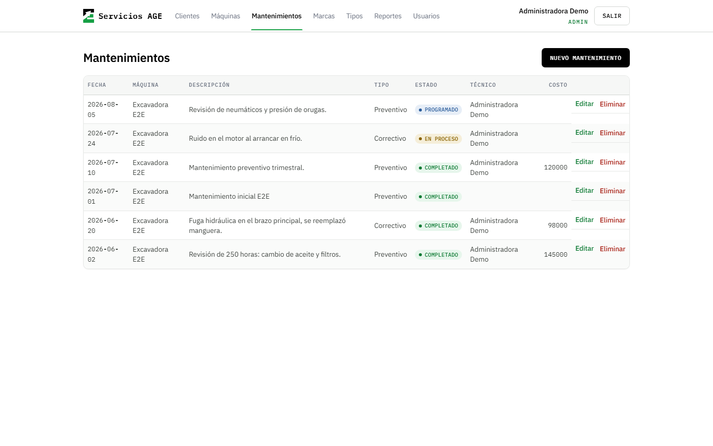
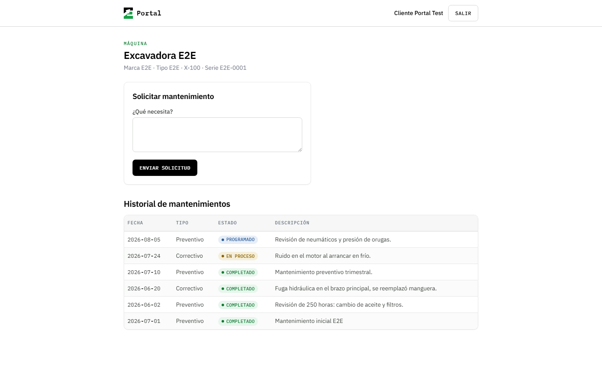

# Servicios AGE

Servicios AGE maintains industrial equipment — mostly forklifts — for companies in Costa Rica. Until mid-2026 every service job was recorded in an Excel workbook.

The workbook was fine at storing what happened and bad at everything after that. Pulling one client's history meant filtering by hand. Scheduled jobs slipped because nothing surfaced them. Clients called to ask when their machine was due, and answering took someone opening the file and reading. When a client wanted to see what had actually been done to a machine over the past year, the report was rebuilt from scratch every time.

That last one is what actually paid for this project. The business wanted to show clients its work (per machine, over a period) without reconstructing the answer by hand.

This is what replaced the workbook: an internal panel for staff, and a separate portal where each client sees their own equipment and service history and can request service.

Currently in production with 5 internal users and 2 client companies.

## Where this came from

The first version was a 2023 university project for a software engineering
course at TEC, built by three of us: a native Android app in Kotlin, a Flask
API, and SQL Server with 25 stored procedures that assembled JSON by hand. The
Android client pointed at a hardcoded ngrok tunnel. Passwords were hashed
manually with bcrypt in the API. The test suite was one pytest smoke test
against `/login`. It was never used for anything. The original is at
[`AlonsoNav/AGServicios`](https://github.com/AlonsoNav/AGServicios).

I owned the database layer on that team, which means those 25 stored procedures
were mine.

In 2026 the business needed what the course project had described, so I rebuilt
it alone — new stack, no shared code, and a hard look at which parts of the
original idea were worth keeping. Most weren't. The stored procedures went
first, which is to say the first thing I did was delete my own work:
application code with generated types is easier to change and possible to test.
Auth moved to a managed provider instead of hand-rolled hashing. The hardcoded
tunnel became environment variables. What survived was the domain model —
clients, machines, brands, machine types — because that part was right.

## What it does

Staff manage clients, machines, brands, machine types, and maintenance records, and export the catalog as CSV. Admins additionally create internal accounts and assign roles.

Clients log into a separate portal, see only their own machines and service history, and submit maintenance requests.

## Screenshots

Internal panel — client list:



Maintenance registry, as staff see it:



The same machine and the same six records, as its client sees them in the portal:



## Design decisions

**Authorization lives in the database.**

The first implementation checked permissions at the route layer: the portal rendered client-scoped views, the panel rendered staff views, and access was decided by which route you reached. That held until I tried navigating to the brands and machine types screens as a client. They loaded. The tables underneath were readable by any authenticated session, and nothing below the route was stopping anyone.

The fix was to stop treating the route as the boundary. Authorization moved into Postgres row-level security policies with least-privilege grants, so the query itself returns nothing a session isn't entitled to, regardless of which page issued it. The route checks stayed as a first filter — they produce better errors than an empty result set — but they are no longer what enforces anything.

The system has three layers of access control because the first two were not enough on their own. That is the reason, not an architecture preference.

**Maintenance records are archived, not deleted.**

Deletion of a maintenance record is a soft archive. A hard delete is permanent, and maintenance history is the thing clients dispute and the thing the business bills against — the one table where an accidental click should not be final. Everything else deletes normally.

**Logo assets are PNG, not SVG.**

The obvious choice was a scalable SVG. The SVG in hand was 108 KB, because it was this project's 3000px raster wrapped in an `<svg>` element rather than real vector art. The application renders the logo at three fixed, known sizes, so four PNGs rendered at their final dimensions total about 32 KB and are sharper. The reasoning and the contrast ratios behind the color system are in [`docs/marca.md`](docs/marca.md).

## Stack

Next.js 15 (App Router) and TypeScript on Vercel. Supabase for Postgres, Auth, and row-level security. Data access goes through the Supabase JS client with its generated types — no ORM. Tailwind for styling. Seven versioned migrations. Vitest for unit tests, Playwright for end-to-end.

## Running locally

Requires Node 20+ and Docker. The Supabase CLI ships as a dev dependency, so it runs through `npx` — no global install.

```bash
npm install
npx supabase start        # local Postgres and Auth in Docker
```

`supabase start` prints the credentials for the local instance. Copy `.env.local.example` to `.env.local` and fill it in:

| Printed as         | Goes into                       |
| ------------------ | ------------------------------- |
| `API URL`          | `NEXT_PUBLIC_SUPABASE_URL`      |
| `anon key`         | `NEXT_PUBLIC_SUPABASE_ANON_KEY` |
| `service_role key` | `SUPABASE_SERVICE_ROLE_KEY`     |

The four `E2E_*` variables are not printed by anything. `E2E_ADMIN_EMAIL` and `E2E_ADMIN_PASSWORD` are yours to choose, and have to match what you pass to the seed script below. `E2E_CLIENT_EMAIL` and `E2E_CLIENT_PASSWORD` are fixed by `scripts/seed-portal-test.ts` — the values are in `.env.local.example`.

Then apply the schema, create the first administrator, and seed the client-side test data:

```bash
npx supabase db reset
npx tsx scripts/seed-admin.ts <email> <password> "<full name>"
npx tsx scripts/seed-portal-test.ts
npm run dev
```

The portal seed is not optional if you intend to run the tests: several specs need a client account with at least one machine, and the maintenance form needs a machine to select.

## Tests

```bash
npm run test:unit
npx playwright install     # first run only
npm run test:e2e
```

The end-to-end suite runs with a single worker. The specs share one dev server that compiles routes on demand and one local Supabase instance; running the files in parallel exhausted both and produced timeouts indistinguishable from real failures.

## Limitations

The internal panel has no per-machine detail view. Staff reach a machine's history through the global maintenance registry, filtered — workable at the current record count, less so later.

Reports export as CSV only. The original design called for PDF, which was dropped to avoid a rendering dependency for something Excel opens anyway. If a client ever needs a formatted document, this has to be revisited.

Rentals and transactions are not tracked. Neither were in the 2023 project and the business does not need them yet.

The deployment runs on Supabase's free tier, which does not retain backups. Moving to a paid tier is pending on the client's side.

## Documentation

Dated design records live in [`docs/design/`](docs/design/) — what was decided before each phase was built, kept unedited. They do not always describe the system as it stands; the notes at the top of each say what changed.

Project documentation is written in Spanish, because the business and whoever maintains this are Spanish speakers. Anything addressed outward, including this file, is in English.
