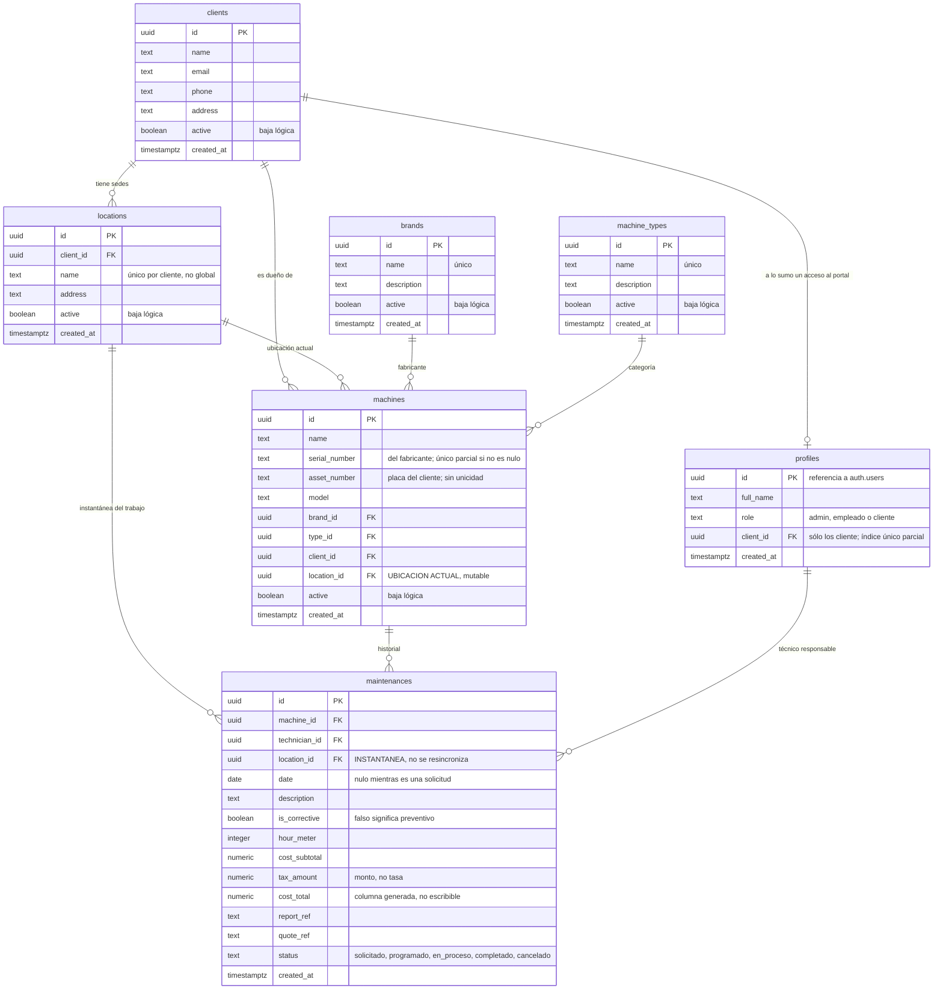
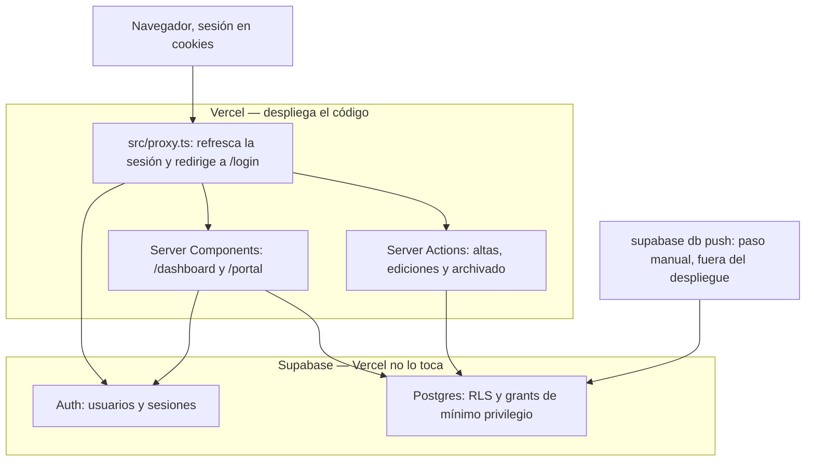
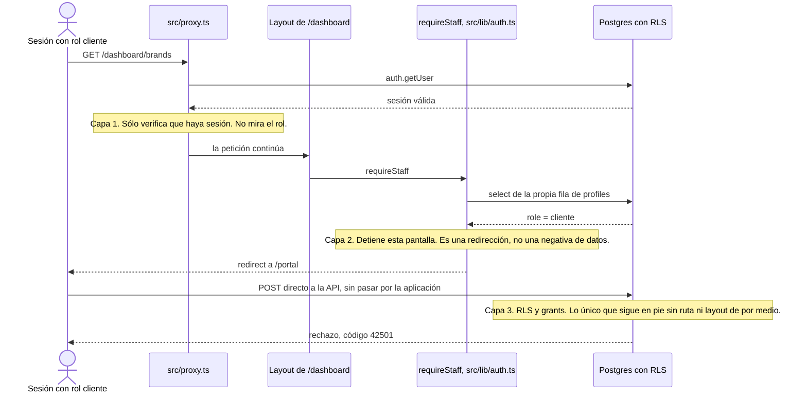
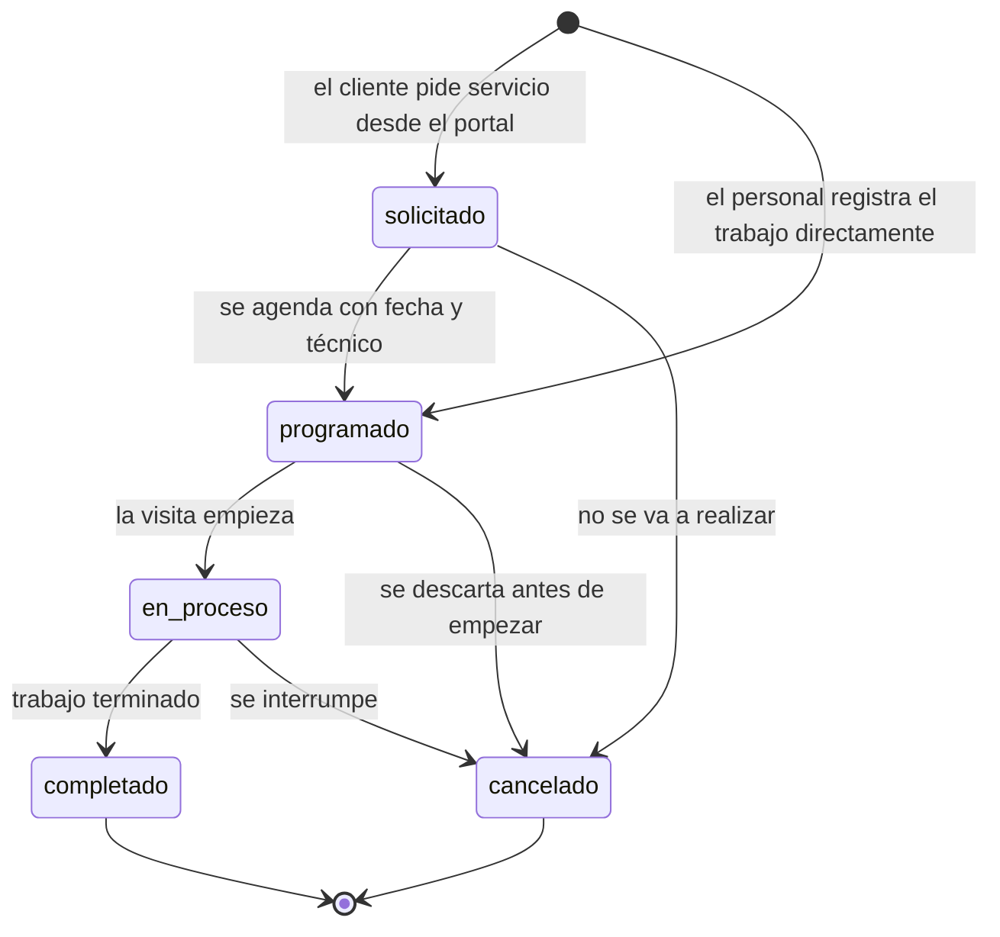
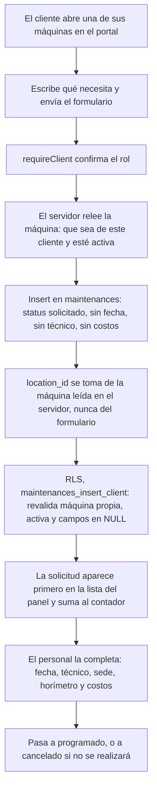

# Arquitectura — Servicios AGE

Este documento reúne los cinco diagramas de referencia del sistema. Cada uno va
acompañado de la lectura de la decisión que representa, porque el diagrama por sí
solo muestra la forma pero no el motivo.

Está dirigido a quien tenga que mantener o retomar el proyecto. El manual
operativo, escrito para el personal de la empresa, es
[`manual-usuario.md`](manual-usuario.md); el detalle de stack, migraciones,
entorno y pruebas está en [`manual-tecnico.md`](manual-tecnico.md).

**Estado del sistema al que se refieren estos diagramas:** el código está
construido y desplegado, pero no ha entrado en uso. No existen usuarios internos,
no existen empresas cliente con acceso al portal y no se ha cargado ningún dato de
negocio. Lo que se describe aquí es la estructura del sistema, no una operación en
marcha.

---

## 1. Modelo de datos

Las dos columnas `location_id` del diagrama llevan el mismo nombre y significan
cosas distintas, y esa es la decisión central del modelo. En `machines` es la
ubicación **actual** de la máquina y está pensada para editarse: los clientes son
cadenas con varias tiendas y se prestan las máquinas entre ellas, así que mover
una máquina es cambiar ese campo. En `maintenances` es una **instantánea** de
dónde se realizó el trabajo, capturada en el momento y nunca resincronizada. Si
fuese una referencia viva, prestar una máquina reescribiría en silencio todo su
historial de servicio, y mostrar ese historial a un cliente es la razón por la que
existe el proyecto.

La relación entre `clients` y `profiles` es de uno a como máximo uno, y no la
sostiene una clave foránea sino un índice único parcial,
`profiles_client_id_unique`, definido sobre `profiles(client_id) where client_id is
not null`. El índice es parcial porque los perfiles internos —`admin` y
`empleado`— tienen `client_id` nulo y no deben quedar restringidos entre sí. Sin
ese índice, dos altas concurrentes de acceso al portal crearían dos perfiles para
el mismo cliente, y la baja del cliente, que busca el perfil vinculado con
`.maybeSingle()`, fallaría sin avisar.

`cost_total` es una columna generada y almacenada, no un campo que la aplicación
escriba: la base la calcula como la suma de `cost_subtotal` y `tax_amount`, y sólo
la deja nula cuando ambos lo están. Que el impuesto se guarde como **monto** y no
como tasa es deliberado; un cambio en el IVA nacional no debe alterar
retroactivamente registros ya facturados, y cada uno debe seguir coincidiendo con
la boleta emitida ese día. La convención asociada —vacío significa dato no
digitado, y un servicio exento se registra con `0`— está explicada en el
[manual de usuario](manual-usuario.md).

---

## 2. Despliegue

La aplicación no tiene servidor propio ni capa intermedia: los Server Components
leen de Postgres y las Server Actions escriben en él, ambos a través del cliente
`supabase-js` con la sesión del usuario. No hay ORM. El único código que corre con
privilegios elevados es el que usa el cliente de rol de servicio, reservado para
crear usuarios de autenticación y perfiles, y aislado tras `import 'server-only'`
para que incluirlo en un componente de cliente sea un error de compilación.

El detalle que gobierna todo el procedimiento de publicación está en la flecha que
entra a Postgres desde fuera de ambas cajas: **Vercel despliega código, no
migraciones**. Publicar en la rama principal actualiza la aplicación, pero el
esquema de la base sólo cambia cuando alguien ejecuta `supabase db push` a mano. El
orden correcto es siempre aplicar la migración, verificar el esquema remoto y sólo
entonces publicar el código que la asume; invertirlo deja la aplicación pidiéndole a
la base columnas que no existen.

Ese riesgo no es hipotético: ya ocurrió. La octava migración —sedes, desglose de
costo, horímetro y referencias documentales— estuvo aplicada únicamente en el
entorno local mientras el código que la asumía ya estaba escrito, y la
documentación siguió describiéndola como pendiente incluso después de aplicarla.
**Verificado el 2 de septiembre de 2026, el esquema remoto está al día: las nueve
migraciones aplicadas y el historial local y el remoto alineados.**

Que el desfase esté resuelto no cambia el diagrama. El paso sigue siendo manual y
sigue estando fuera de la caja que Vercel despliega, así que el mismo desfase puede
repetirse en la próxima migración; la deuda técnica correspondiente sigue abierta en
el [manual técnico](manual-tecnico.md).

---

## 3. Autorización en tres capas

Las tres capas existen porque las dos primeras resultaron insuficientes. La
implementación original decidía el acceso por ruta: el portal renderizaba vistas de
cliente, el panel renderizaba vistas de personal, y quedaba decidido por la página
a la que se llegara. Al navegar como cliente a la pantalla de marcas, la página
cargó, porque las tablas de debajo eran legibles por cualquier sesión autenticada y
nada por debajo de la ruta detenía a nadie.

En el recorrido del diagrama conviene ser preciso sobre qué detiene qué. El proxy
(capa 1) sólo comprueba que exista una sesión y no examina el rol, de modo que deja
pasar la petición. Quien impide que **esta pantalla** se muestre es `requireStaff`
en el layout del panel (capa 2), que redirige al portal. Pero esa capa es una
redirección conveniente, no una frontera: produce mejores errores que un resultado
vacío y nada más. La frontera real es la capa 3, y se demuestra en el segundo tramo
del diagrama, donde la petición evita por completo la aplicación y habla directo
con la API: ahí no hay ruta que redirija y lo único que responde es la política de
la base.

Sobre `brands` en particular hay un matiz que conviene no exagerar. Su política de
lectura sigue siendo abierta para cualquier sesión autenticada, a propósito: marcas
y tipos de maquinaria son etiquetas de catálogo, no datos de un cliente. Lo que RLS
impide sobre esas tablas es **escribir** sin ser personal de la empresa. Donde RLS
sí restringe la lectura es en las tablas que llevan datos de negocio: un `cliente`
sólo ve su propia fila de `clients`, sus sedes, sus máquinas y los mantenimientos de
esas máquinas. Las funciones auxiliares `is_admin()`, `is_staff()` y
`current_client_id()` son `security definer` para evitar consultas recursivas contra
`profiles`, y los privilegios son de mínimo: `anon` no tiene nada, `authenticated`
sólo DML, el rol de servicio todo.

---

## 4. Estados de un mantenimiento

Los cinco valores están fijados por una restricción `check` sobre la columna
`status`, y `programado` es el valor por omisión de la columna. `solicitado` y
`cancelado` se incorporaron con la tercera migración, cuando el portal ganó la
capacidad de pedir servicio: una solicitud es un mantenimiento que todavía no tiene
fecha —por eso `date` pasó a admitir nulos— y `cancelado` es el cierre de un trabajo
que no se realizará.

Conviene leer este diagrama como el flujo operativo previsto, no como una máquina
de estados que el sistema imponga. **La base restringe el conjunto de valores
posibles, pero no las transiciones entre ellos.** El formulario de edición ofrece
los cinco estados a la vez, así que una persona del personal puede llevar un
registro de `completado` de vuelta a `en_proceso` sin que nada lo impida. La única
restricción de transición que sí se aplica es la de entrada: la política
`maintenances_insert_client` obliga a que todo lo que inserte un cliente nazca como
`solicitado`.

`solicitado` es el único estado que exige una acción del negocio, y el sistema lo
trata en consecuencia: esos registros se ordenan primero en la lista de
mantenimientos, la navegación del panel muestra un contador de pendientes y la
página de inicio del panel los cuenta en una tarjeta destacada.

---

## 5. Solicitud de mantenimiento desde el portal

Éste es el único camino por el que un cliente escribe en la base de datos, y está
construido para que el cliente no pueda aportar más que una descripción. La
política `maintenances_insert_client` exige que la máquina sea suya y esté activa,
que el estado sea `solicitado`, y que `date`, `technician_id`, `cost_subtotal`,
`tax_amount`, `hour_meter`, `report_ref` y `quote_ref` lleguen en NULL. La
comprobación equivalente que hace la Server Action antes de insertar no sustituye a
la política: es defensa en profundidad, porque una Server Action es alcanzable por
POST directo.

`location_id` está deliberadamente fuera de esa lista de campos forzados a NULL, y
la razón se ve en el diagrama: no es que el cliente pueda elegirlo, es que **el
servidor lo rellena** con la sede de la máquina que acaba de leer. El formulario del
portal no ofrece ese campo. Así la solicitud nace ya asociada a la tienda correcta
sin que el cliente decida dónde queda registrado el trabajo.

De ahí en adelante el registro es uno más del panel. El personal lo completa con
los datos que le corresponden y le cambia el estado; el cliente no puede editarlo
ni cancelarlo, y sigue su avance en el historial de la máquina. Cada columna nueva
de costo o de referencia documental que se agregue a `maintenances` en el futuro
tiene que sumarse a la lista de campos forzados a NULL de esa política, en la misma
migración que la crea: una columna añadida sin actualizar la política es un agujero
por el que un cliente puede escribir su propio precio.
